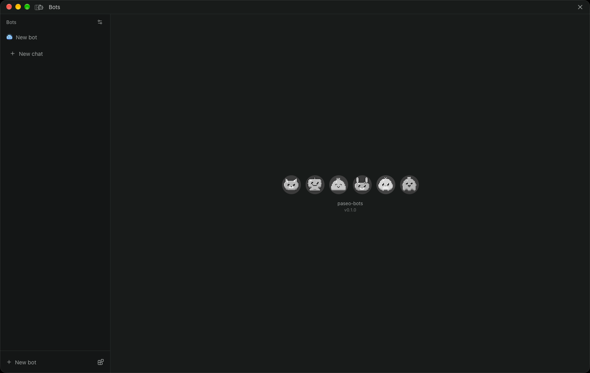
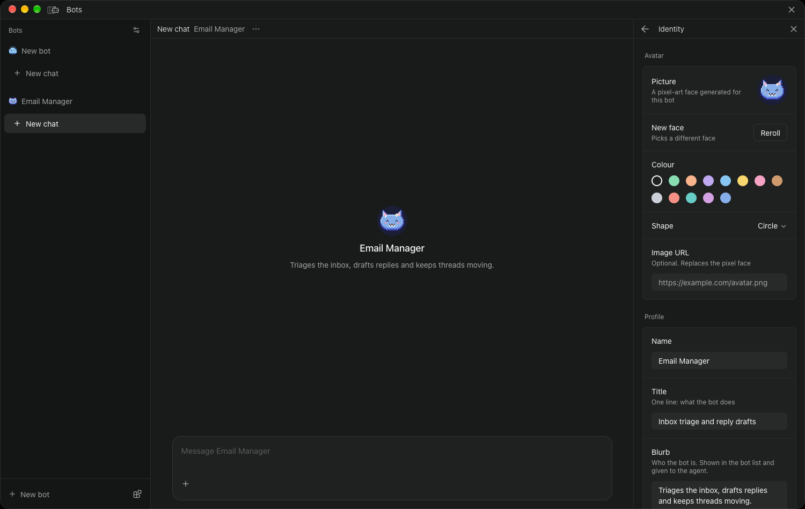
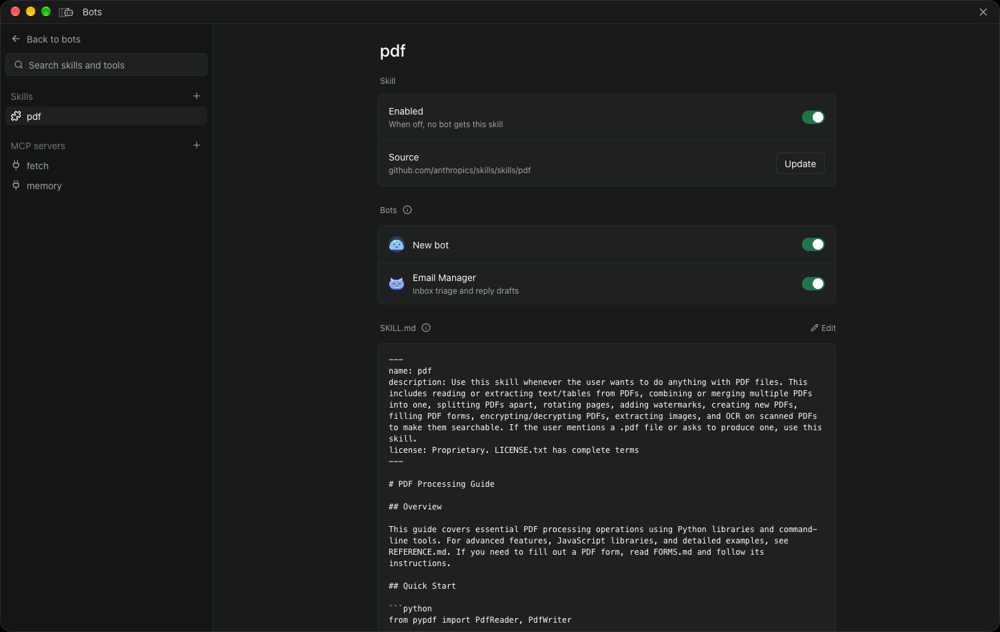
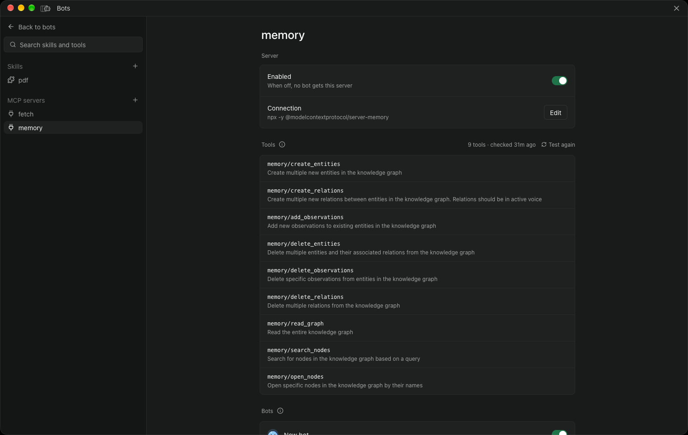
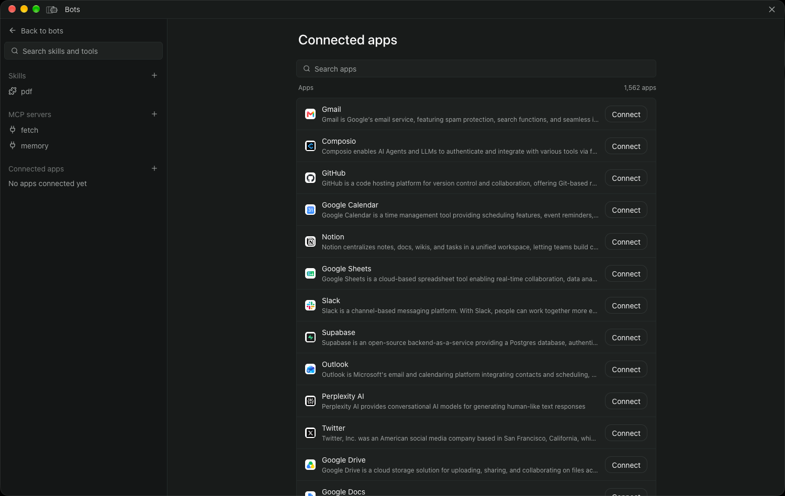
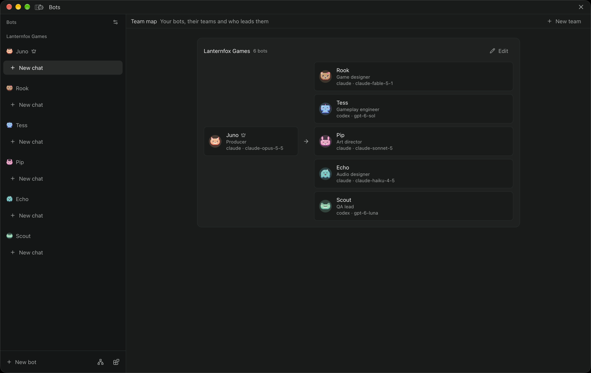

<p align="center">
  
</p>

# paseo-bots

Personal bots for [Paseo](https://paseo.sh). Give each bot instructions, a model, memory, skills and tools, then chat with it in Bots or let it run routines. New chats use background workspaces to keep them separate from the coding sidebar. Bots runs in the standard Paseo app; no custom build or host patch is required.

## Core Features

| Feature | Description |
| --- | --- |
| **Bots** | Instructions, provider and model, host, approval mode and an avatar. Start blank or from a role such as Email triage or Researcher, or ask a bot to set them up. |
| **Memory** | Each bot keeps a `MEMORY.md` it updates as it learns, and a daily log of its chats. |
| **Routines** | Cron schedules with time zones, fixed intervals, one-time runs and local webhooks. Manage run history, pause schedules and stop active runs. |
| **Teams** | Put bots on a team with a Chief of Staff, who takes your requests and hands parts to the others. Each team gets a tab and a pixel-art logo. |
| **Skills & Tools** | One library of skills and MCP servers, switched on per bot. Import skills from GitHub and MCP servers from Claude Code, Claude Desktop or Cursor. |
| **Learning** | Send `/learn` after a task and the bot writes it up as a skill. |
| **Connected apps** | Apps such as Gmail, Slack and Notion from [Composio's](https://composio.dev) catalog, with several named accounts per app. |
| **Paseo tools** | Bots can start other agents, open workspaces, set up schedules and use the browser. |
| **Interactive chat** | Review editable drafts, answer forms, select options and confirm actions in the conversation. Completed tool steps collapse together; search results have source cards. |
| **Conversations** | Threads beneath each bot, pinned chats, saved messages, search and device-local reply drafts. Handoff cards link to another bot's conversation. |
| **Avatars** | Built-in pixel, modern and orbital generators with a seed, palette and shape, plus custom image uploads. No image service or API key is needed. |
| **Quick access** | One Bots entry in Paseo's sidebar. Search and pin bots inside Bots, and manage routines from Bot list options. |

## Screenshots

These screenshots show the earlier UI. The usage guide below describes the current controls and navigation.

| | |
| --- | --- |
| **Bots** | **Bot settings** |
|  |  |
| **Skills** | **MCP servers** |
|  |  |
| **Connected apps** | **Teams** |
|  |  |

## Install

Requires Paseo **0.16.0 or later** on the host and connected clients, with plugins enabled and an agent provider configured. Install a published release with:

```bash
paseo plugin install npm:@oliexe/paseo-bots
```

Or paste `npm:@oliexe/paseo-bots` into **Settings → Plugins → Plugin source** in Paseo. To update an npm installation, run `paseo plugin update paseo-bots`.

To run the current repository version, install a local checkout on the Paseo host:

```bash
git clone https://github.com/oliexe/paseo-bots.git
cd paseo-bots
npm ci
paseo plugin install "$PWD"
```

For an existing checkout, pull changes, run `npm ci`, then `paseo plugin reload paseo-bots`. Installations are per host; choose that host in Paseo when opening Bots.

You can use Bots through Paseo's desktop, browser or mobile client, including when the Paseo host runs on another machine. Separately, a bot's **Host** setting can send its chats to another machine. That target does not receive this installation's memory, skills, connected apps or bot tools, so handoffs and `/learn` are unavailable there. File uploads also require the bot to run on the host selected for Bots; images and text attachments work with other targets. For all features on another machine, install Bots there and select that installation in Paseo.

## Usage

### Bots

1. Open **Bots** in Paseo's sidebar and press **New bot**. Start blank, from a role, from one of your presets, or paste a bot or team file under **Import**.
2. Expand a bot to see its threads. Press **+** beside the bot or **New chat** beneath it to start a conversation. New chats use the bot's hidden background workspace; **Open in Paseo** in a chat's menu opens it in Paseo's workspace view.
3. Open its settings with the panel button at the top right of a chat, or **Open bot settings** in the bot's menu. **Identity** holds the name, avatar and voice, **Soul** its standing instructions, **Model** the provider and model, and **Permissions** the approval mode.

Bots can do the setting up too. Ask one in a chat, for example "Create a research team of three bots with Scout as Chief of Staff", and it shows every change on one card; **Apply changes** makes them. A bot can create, edit and delete bots, teams, routines, library skills and MCP servers, and change what new bots start with. Each bot's earlier settings stay under **History** in its settings.

Use **Pin to top** in a bot's menu for quick access. The same action on a chat puts it in the **Pinned** section. **Find bots…** filters the bot list; **Bot list options** controls archived bots and chat order. Threads stay nested beneath bots inside the single **Bots** sidebar entry. Existing conversations remain accessible, and older visible workspaces keep their original visibility. Command Center also offers **Open Bots** and **New bot**.

The chat menu also offers **Copy transcript**, **Copy path**, **Copy chat ID** and **Archive**.

### Drafts and sending

Unsent replies and their attachments are saved on this device, separately for each host, bot and chat. They restore when you return to the conversation. Failed sends keep the reply available for retry. Queued messages are separate from saved drafts and last only for the current app session.

Draft storage keeps up to 50 recent replies within a 2 MB budget. Large image attachments and older drafts may be omitted on reload; a single oversized reply may be shortened to fit.

While a bot is working, sending follows Paseo's **When the agent is working** preference. **Stop agent** interrupts its current work and pauses queued replies while preserving the conversation. It cannot undo actions the bot already completed.

On desktop and web, use **+** to add images or files, or drag them into the composer. Mobile clients offer **Paste text**. Use **Find in chat** in the chat header to search a conversation.

### Memory

A bot updates its `MEMORY.md` when it learns something worth keeping, for example when you say "Remember that I prefer short answers". New chats start with it.

In the bot's settings, **Memory** shows `MEMORY.md` and its topic files, which you can edit, a **Daily log** of its chats, and **Changes**, where **Undo** puts a file back the way it was.

The memory panel shows how much enters each chat: up to 200 lines or 24 KB of `MEMORY.md`. It warns when the end is left out; topic files remain available for the bot to read when needed. If a file changes while you are editing it, saving reports the conflict instead of overwriting the newer version.

### Routines

1. In the bot's settings, open **Routines** and press **New routine**.
2. Give it a name and a prompt. The prompt is the first message of each run.
3. Pick when it repeats: a preset such as **Weekdays 9:00**, your own cron expression, a **Fixed interval** of 5–1440 minutes, **Once**, or **When its webhook is called**.
4. To collect results in one place, pick a chat under **Post results to**. Each run still gets its own chat.

Bots can propose routines too: ask in a chat, then press **Create routine** on the card. A webhook routine's URL is under **Copy webhook URL** in its menu; `POST` to it from this computer.

For an overview across bots on the current host, open **Bot list options** beside the Bots list heading, then **Manage routines**. It includes search, pause/resume, manual runs and run history. Cron routines can use an explicit IANA time zone; otherwise they follow the host's time zone. Interval routines retain their cadence across restarts. Scheduled and manual triggers skip a routine while an earlier run is working or waiting for permission; webhooks allow up to three unfinished runs.

Routines run on the host that stores the bot and are unavailable when that bot targets another host. The daemon must remain running, but an open Bots screen is not required. Unattended startup uses the installed `paseo` CLI, which must be available on the daemon's `PATH`.

Ask a bot to list its routines and recent runs, run a routine now, or stop an active run. The `list_routines`, `run_routine` and `cancel_routine_run` tools operate on that bot's routines. Stopping a run keeps its conversation and history, leaves its schedule unchanged, and cannot undo actions already completed.

You can also open **Activity → Runs** in a bot's routines and press **Stop** for an active run. The same control is available from the routines overview. If interruption fails, the run stays visible with **Retry stop**; a run that finishes during the request keeps its actual outcome.

### Interactive chat

Bots can show confirmation cards, single- or multiple-choice questions, forms and editable drafts with the `show_card` tool. Your answer returns to the original chat. Approving a draft sends its edited content back to the bot; it does not itself send an email or publish anything. **Add to reply** puts a draft in the composer and preserves text already there.

Cards retain their answers across reloads and reject changed answers after submission. Failed deliveries can be retried with the same answer. Successful background tool calls are grouped into expandable steps; active calls, failures and cards that need an answer stay visible. Search and fetch results expose clickable sources.

In Bots, recognized card answers appear as readable confirmations and labeled fields; **Show original response** reveals the full message sent to the bot. Some restored conversations may show the original response instead. User and assistant messages have **Quote in reply** and **Save message** actions. Open **Saved messages** from the chat header to return to the original message. Bookmarks sync with the host and stay out of bot and team exports.

When one bot asks another for help, a handoff card shows the receiving bot's status and latest reply. **Open conversation** takes you to that bot's chat; **Review request** appears when it needs approval. Each bot retains its own tools and permissions.

`ask_bot` sends a completion update back to the asking chat, including when `wait: false` is used or the 50-second wait expires. Set `notify: false` on a call to check the answer manually with `check_chat`. Updates include the delegated chat ID and a shortened answer. They wait while the asking chat is busy or awaiting approval; archived or deleted chats are not reactivated. Pending updates are saved on the host and retried after a connection failure or plugin reload. Paseo acknowledges bot messages before dispatch, so a daemon crash at that point can lose an update; `check_chat` remains available to retrieve the answer.

### Avatars and defaults

Open **Identity → Picture**, choose **Pixel**, **Modern** or **Orbital**, then adjust the palette, seed and shape. These built-in generators work without an image service or API key. Desktop and web clients can upload a picture; every client can use an image URL.

In **New bot**, press **Configure** beside **Defaults for new bots** to set the provider, model and permissions inline. **Manage** under **Your presets** lets you delete saved presets without changing bots created from them. Shared apps, skills and MCP servers remain under **Skills & Tools**. Controls use Paseo's UI and appearance settings.

### Teams

1. Press **Team map** at the bottom of the bot list, then **New team**.
2. Name the team, switch on its members, pick a **Lead** as its Chief of Staff, and add shared instructions for every member. The team gets a pixel-art logo; **Reroll** draws another, or use your own picture.
3. Send your requests to the Chief of Staff. It hands parts of the work to its teammates.

With teams, the Bots screen gets a tab for each team, and **Other bots** for bots without one (a menu on phones); **+** next to the tabs adds a team, and right-clicking a tab edits it. To import or export your bots and their teams together, open **Team map**, then **Team file** in its toolbar.

Bot and team files can include memory and skills. Imported routines start paused, imported skills need review, and MCP credentials must be entered again. Chat history, saved-message bookmarks and device drafts are not included.

Whether a bot may ask others for help is set in its settings under **Permissions → Contact other bots**: **Ask first**, **Allowed** or **Off**.

### Skills & Tools

Press **Skills & Tools** at the bottom of the bot list.

- **Skills**: press **+** to import skills from GitHub (`owner/repo`, a folder or a `SKILL.md` link) or write a new one. Open an imported skill and press **Review** to turn it on.
- **MCP servers**: press **+**, then **New server**, or **Import config** to pick up the servers set up in Claude Code, Claude Desktop or Cursor. Press **Test and turn on** on the server's page.

Then give them to a bot in its settings: skills under **Skills**, MCP servers under **Access**.

### Learning

After a task, send `/learn` in the chat, or `/learn <what to focus on>`. The bot writes up what worked as a skill and shows it as a card; press **Save skill** to add it to Skills & Tools and turn it on for that bot.

### Connected apps

Connected apps use your personal Composio account and its existing app connections. Sign-in works from desktop and mobile, including when the Paseo host runs elsewhere.

1. In Paseo, open **Bots**, then **Skills & Tools** at the bottom of the bot list.
2. Open **Connected apps** and press **Sign in to Composio**.
3. Approve the sign-in in your browser. Check that the approval code matches the one in Bots.
4. Find an app, press **Connect** and finish signing in in your browser.
5. Switch the app on for a bot under the bot's **Access** settings, or on the app's page.

Existing project-key installations keep working. Signing in switches Bots to your personal Composio project; connections in the old project stay there. Signing out removes credentials from this host and leaves app connections in Composio.

To add a second account of an app, such as a work and a personal Gmail, open the app's page and press **Connect** next to **Add another account**. Bots pick an account by its name.

When a bot needs an app that isn't connected, its chat shows a card: press **Sign in**, finish on Composio's page, then **Continue**. Signing in from the card also switches the app on for that bot.

To limit what a bot does with an app, open the app under the bot's **Access** settings: allow all of its tools, only the read-only ones, or the ones you choose, and keep the bot to one account. The relay refuses anything else, and turns off Composio's remote workbench for bots with limits, since code there could run any app's tools.

Your Composio credentials stay on the Paseo host and never reach the agents: bots reach Composio through a local relay that only lets each bot use the apps you switched on for it.

### Paseo tools

Bots get Paseo's own tools, so you can ask one in a chat to start other agents, open workspaces and terminals, set up schedules or use the browser. A bot's **Access** settings show whether they're on, and **Turn on** there switches them on for every agent on the host.

## Development

```bash
npm ci
npm test
npm run typecheck
paseo plugin reload paseo-bots
```

The reload command applies changes to a local checkout already installed on that host. `paseo plugin ls` shows its status; `paseo plugin logs paseo-bots` shows startup and runtime errors. Source changes do not require restarting the Paseo daemon.
